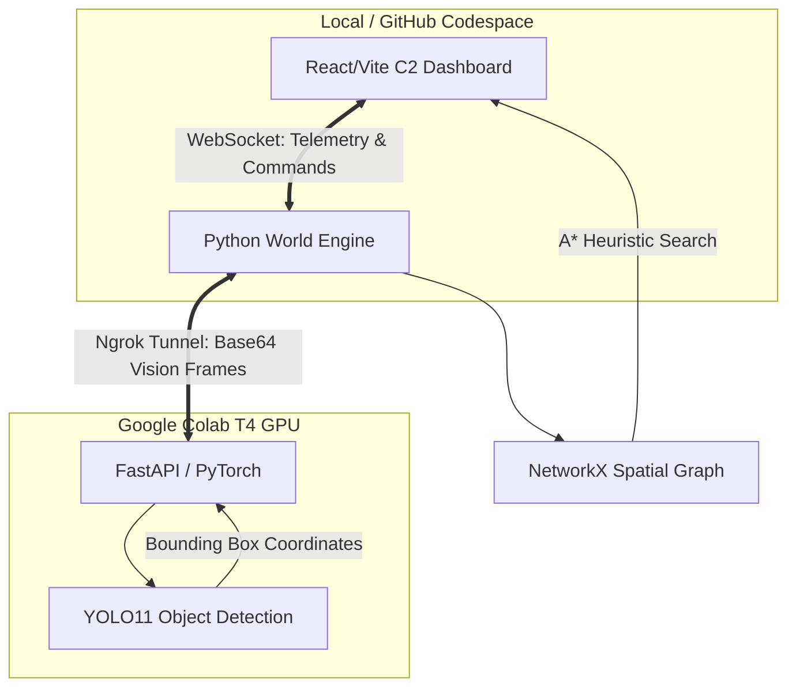

# TitanOPS-AIR
A distributed Air-Ground Collaborative Swarm Intelligence platform. Utilizes Graph Neural Networks (GNNs) and Heterogeneous Multi-Agent Reinforcement Learning (MARL) for dynamic threat routing and autonomous logistics.

# 🛡️ TitanOPS AIR: Overwatch Nexus Architecture


> **A distributed, hardware-decoupled Command & Control (C2) architecture for autonomous drone swarm interception, integrating Deep Learning Vision pipelines with real-time heuristic pathfinding and Human-On-The-Loop (HOTL) autonomy.**

## 📖 Executive Summary

TitanOPS AIR is a highly scalable, autonomous targeting and routing simulator built on a first-principles systems engineering mindset. Designed to bridge the gap between heavy neural inference and lightweight edge execution, the architecture offloads raw visual data via WebSocket tunneling to a dedicated cloud GPU, returning deterministic geospatial coordinates to a local React-based command dashboard. 

This project demonstrates production-grade robotic control loops, dynamic spatial graphing, and strictly decoupled ML-to-UI microservices.

## 🏗️ System Architecture & Data Flow

The platform relies on a tripartite distributed architecture, ensuring that heavy tensor operations never block the event loop of the tactical UI.


```
### 1. The Cloud Neural Node (Vision Pipeline)
*   **Hardware:** Deployed on an NVIDIA T4 GPU via Google Colab.
*   **Inference:** Utilizes a PyTorch-backed YOLO11 Convolutional Neural Network (CNN) to process continuous `640x360` video telemetry.
*   **Data Extraction:** The model extracts bounding box geometries `(x1, y1, x2, y2)` and probabilistic confidence scores, executing parallel matrix multiplications to identify targets with minimal latency.

### 2. The Python World Engine (Applied AI & Algorithmic Routing)
*   **Pixel-to-Grid Projection:** Translates YOLO pixel coordinates into real-world geospatial grids using `NetworkX`.
*   **Dynamic Topology:** Continuously destructs and reconstructs graph nodes around moving targets to calculate a "lethal blast radius" and no-fly zones.
*   **Heuristic Navigation:** Implements the A* (A-Star) search algorithm to calculate the optimal extraction or interception routes for Ground/Air Vehicles (UGV/UAV) in real-time.

### 3. The Overwatch C2 Dashboard (Frontend)
*   **Framework:** Built on React and Vite for sub-millisecond DOM repaints.
*   **CSS Grid Optimization:** Employs absolute-positioned feeds decoupled from CSS Grid physics to prevent layout blowout during heavy video frame rendering.
*   **Tactical Autonomy Modes:**
    *   **HITL (Human-In-The-Loop):** System locks targets and halts execution pending explicit manual commander authorization.
    *   **HOTL (Human-On-The-Loop):** AI Autopilot engages, dynamically overriding manual systems to neutralize all mapped threats instantaneously based on the vision pipeline.
```[cite: 12]

## 🚀 Deployment & Ignition Protocol

Due to the decoupled nature of the GPU processing and the UI dashboard, the system must be brought online in a specific ignition sequence.

### Phase 1: Ignite the Neural Brain (Cloud)
1. Launch the dedicated Google Colab notebook (`brain/colab_inference.ipynb`).
2. Attach a T4 GPU and execute all cells to initialize the PyTorch environment.
3. Extract the generated `ngrok-free.app` URL from the output log.

### Phase 2: Configure the World Engine (Backend)
1. Clone the repository to your local machine or cloud development environment.
2. Update the `COLAB_API_URL` variable in `world/network_bridge.py` with the fresh Ngrok tunnel address.
3. Install dependencies:
   ```bash
   pip install websockets requests networkx matplotlib opencv-python-headless
   ```
4. Boot the WebSocket bridge:
   ```bash
   python world/network_bridge.py
   ```

### Phase 3: Launch the C2 Nexus (Frontend)
1. Open a secondary terminal and navigate to the UI directory:
   ```bash
   cd titanops-ui
   ```
2. Install Node dependencies and boot the Vite server:
   ```bash
   npm install
   npm run dev
   ```
3. Ensure port `5173` (Vite) and `8765` (WebSocket) are exposed to the public network, then launch the `localhost` URL in your browser.

## 🛡️ Operational Directives

By default, the architecture strictly enforces a **"Manual-by-Default"** security posture. Upon boot, the weaponized swarm system initializes in *Standby* mode. The C2 dashboard will log `[HOLD] Target locked. Awaiting manual commander authorization.` until the operator explicitly engages the AI Autopilot or executes a manual strike.

## 📄 License

This project is licensed under the **Apache License 2.0**. See the [LICENSE](LICENSE) file for details.
